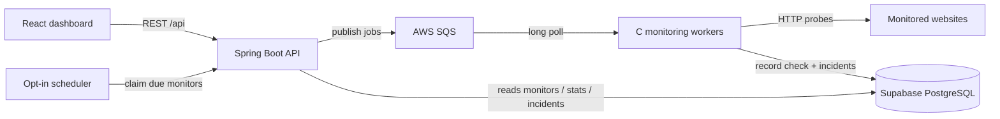

# NetPulse

Distributed website monitoring platform that schedules HTTP checks, runs them on a multithreaded C worker fleet via AWS SQS, records results in PostgreSQL, detects outages and recoveries, and surfaces analytics in a React dashboard.

Built as a backend-focused portfolio project for software engineering internship applications.

## Tech stack

| Layer | Technologies |
|-------|----------------|
| API & scheduler | Java 21, Spring Boot, JDBC |
| Monitoring worker | C11, libcurl, libpq, pthreads, AWS SigV4 |
| Messaging | AWS SQS (`us-east-2`) |
| Database | PostgreSQL (Supabase) |
| Dashboard | React, TypeScript, Vite, Tailwind CSS, Recharts |

## Key features

- **Automatic website monitoring** — periodic HTTP(S) probes with configurable intervals
- **Distributed workers** — SQS-backed C workers scale independently of the API
- **Job scheduling** — durable leases with `FOR UPDATE SKIP LOCKED` (opt-in scheduler)
- **Incident detection** — opens an incident after two consecutive failures
- **Recovery tracking** — resolves the open incident after one successful check
- **Analytics dashboard** — uptime, latency charts, recent checks, and incident history

## Architecture



**Flow:** the API (or scheduler) enqueues a monitoring job on SQS → a C worker receives it, probes the URL, and calls `netpulse_record_monitoring_check` in PostgreSQL → the function inserts the check and opens/resolves incidents atomically → the dashboard reads monitors, checks, stats, and incidents from the API.

## Repository layout

```
backend/              Spring Boot API, scheduler, SQL migrations
monitoring-engine/    C probe CLI + SQS worker
frontend/             React + TypeScript dashboard
```

## Local setup

### Prerequisites

- JDK 17+ (21 preferred) and Maven
- Node.js 20+
- MSYS2 UCRT64 (or Linux) with `gcc`, `make`, `libcurl`, `libpq`
- Supabase PostgreSQL project
- AWS account with an SQS queue in `us-east-2`
- SQL migrations `001`–`006` applied in the Supabase SQL Editor (`backend/db/migrations/`)

### 1. Environment

```powershell
cd backend
Copy-Item .env.example .env   # fill NETPULSE_DB_* and AWS values; never commit .env
```

Required variables (also listed in `backend/.env.example`):

| Variable | Purpose |
|----------|---------|
| `NETPULSE_DB_URL` | JDBC URL (`sslmode=require`) |
| `NETPULSE_DB_USER` | Database user (pooler: `postgres.<project_ref>`) |
| `NETPULSE_DB_PASSWORD` | Database password |
| `AWS_REGION` | `us-east-2` |
| `NETPULSE_SQS_QUEUE_URL` | Full SQS queue URL |

Use the AWS default credential chain (`AWS_PROFILE`, env keys, or shared credentials). Do not hardcode secrets.

### 2. Backend

```powershell
cd backend
# Load DB + AWS env vars into this shell
mvn spring-boot:run
```

API binds to `127.0.0.1:8080` by default (**unauthenticated — localhost only**).

Scheduler is **off** unless you set `NETPULSE_SCHEDULER_ENABLED=true`.

### 3. C worker

```powershell
$env:Path = "C:\msys64\ucrt64\bin;C:\msys64\usr\bin;" + $env:Path
cd monitoring-engine
make test
make worker
.\build\netpulse-worker.exe
```

### 4. Frontend

```powershell
cd frontend
npm install
npm run dev
```

Open http://localhost:5173 (Vite proxies `/api` → `http://localhost:8080`).

## API overview

Base URL: `http://127.0.0.1:8080`

| Method | Path | Description |
|--------|------|-------------|
| `GET` | `/api/health` | Liveness |
| `GET` | `/actuator/health` | Actuator health (includes DB) |
| `GET` | `/api/monitors` | List monitors |
| `POST` | `/api/monitors` | Create monitor |
| `GET` | `/api/monitors/{id}` | Get monitor |
| `PUT` | `/api/monitors/{id}` | Update / enable / disable |
| `DELETE` | `/api/monitors/{id}` | Delete monitor |
| `POST` | `/api/monitors/{id}/check` | Enqueue one SQS check job (`202`) |
| `GET` | `/api/monitors/{id}/checks` | Recent check history |
| `GET` | `/api/monitors/{id}/stats` | Uptime / latency summary |
| `GET` | `/api/monitors/{id}/incidents` | Incident history |

Monitored URLs are restricted by an allowlist in both the API and the C worker (SSRF protection).

## Security notes

- The API is intentionally **unauthenticated** and bound to localhost for development.
- Secrets live in environment variables / `.env` (gitignored) — never in source.
- Do not expose the API or worker publicly without auth, TLS, and least-privilege IAM.

## License

Educational / portfolio project. Add a license of your choice before publishing if needed.
