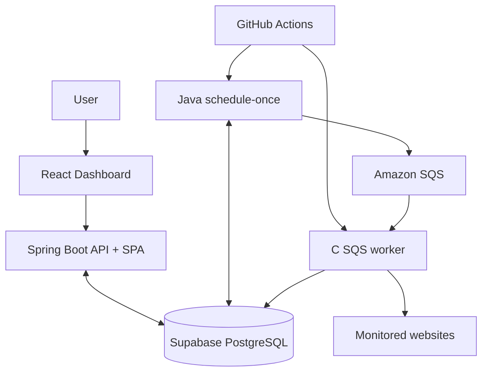

# NetPulse

**A full-stack website uptime monitoring platform built with Java, C, AWS SQS, PostgreSQL, and React.**

NetPulse monitors approved websites, records HTTP availability and latency, tracks uptime history, and opens or resolves incidents when sites fail or recover. Scheduling, check execution, and the dashboard are separated through an asynchronous SQS-backed pipeline.

**[Live Production App](https://netpulse-production.onrender.com) · [Interactive Demo](https://netpulse-dashboard-pcyf.onrender.com)**

## Overview

NetPulse is a portfolio project that connects a Spring Boot API, a native C monitoring worker, Amazon SQS, and Supabase PostgreSQL.

On the free-tier deployment, a GitHub Actions workflow periodically runs a one-shot Java scheduler (claim due monitors → publish SQS jobs) and a bounded C worker (receive jobs → HTTP check → persist results). The authenticated React dashboard is served from the same Spring Boot process on Render and reads monitors, checks, stats, and incidents from PostgreSQL.

## Features

- **Website monitoring** — HTTP/HTTPS availability checks for allowlisted URLs
- **Uptime tracking** — health, response times, check history, and stats in the dashboard
- **Incident detection** — open after two consecutive failures; resolve after one success
- **Asynchronous processing** — Java scheduling publishes jobs to Amazon SQS; the C worker consumes them
- **Monitor management** — create, update, pause, and delete monitors in the UI
- **Authentication** — production management uses Spring Security sessions (BCrypt, HttpOnly cookies, CSRF)
- **Security controls** — URL allowlisting, SSRF guards, no automatic redirects, timeouts, bounded response reads
- **Interactive demo** — sample UI with `VITE_DEMO_MODE=true` (localStorage only; no live checks)

## Tech Stack

| Layer | Technologies |
|-------|----------------|
| Frontend | React, TypeScript, Vite, Tailwind CSS, Recharts |
| Backend | Java 17+ (21 preferred), Spring Boot, Spring Security, JDBC |
| Monitoring engine | C11, libcurl, libpq, AWS SigV4 SQS client |
| Database | PostgreSQL (Supabase) |
| Messaging | Amazon SQS (`us-east-2`) |
| Infrastructure | Docker, Render |
| Automation | GitHub Actions |

## System Architecture



### Monitoring workflow

1. An admin creates a monitor in the dashboard; Spring Boot validates the URL against the allowlist and stores it in PostgreSQL.
2. GitHub Actions starts a headless Java **schedule-once** run (`NETPULSE_SCHEDULE_ONCE=true`).
3. The scheduler claims due rows with `FOR UPDATE SKIP LOCKED` and publishes jobs to SQS.
4. The same workflow runs the C worker, which long-polls SQS, probes each URL (HEAD, with bounded GET fallback), and writes results via PostgreSQL.
5. Incident open/resolve logic runs with the check insert.
6. The dashboard loads monitors, stats, checks, and incidents through the REST API.

On Render Free, keep `NETPULSE_SCHEDULER_ENABLED=false` so a waking web instance does not double-enqueue. Details: [`docs/FREE_DEPLOY_GITHUB_ACTIONS.md`](docs/FREE_DEPLOY_GITHUB_ACTIONS.md).

## Engineering Highlights

- **Queue-backed execution** — scheduling and probing fail independently; SQS buffers work.
- **Transactional scheduling** — PostgreSQL leases and stable `pending_job_id` values reduce duplicate publishes under concurrency.
- **Native worker** — C + libcurl/libpq with allowlisting, timeouts, no redirect following, and capped body reads so large healthy pages (for example Google) are not marked down by size limits.
- **Incidents** — two consecutive failures open an incident; one success resolves it.
- **Production auth** — `NETPULSE_SECURITY_MODE=AUTHENTICATED` with BCrypt admin hash, secure session cookies, and CSRF.

## Repository Layout

```
backend/              Spring Boot API, scheduler, SQL migrations
monitoring-engine/    C probe CLI + SQS worker
frontend/             React + TypeScript dashboard
docs/                 Render and GitHub Actions deployment notes
.github/workflows/    Free-tier monitor workflow
```

## Running Locally

### Prerequisites

- JDK 17+ (21 preferred) and Maven
- Node.js 20+
- `gcc`, `make`, libcurl, and libpq (MSYS2 UCRT64 on Windows, or Linux packages)
- Supabase PostgreSQL with migrations `001`–`006` applied (`backend/db/migrations/`)
- AWS SQS queue in `us-east-2` and credentials via the default provider chain

### 1. Configure environment

```bash
cp backend/.env.example backend/.env
# Edit backend/.env — never commit real secrets
```

| Variable | Purpose |
|----------|---------|
| `NETPULSE_DB_URL` | JDBC URL (`sslmode=require`) |
| `NETPULSE_DB_USER` | Database user |
| `NETPULSE_DB_PASSWORD` | Database password |
| `AWS_REGION` | e.g. `us-east-2` |
| `NETPULSE_SQS_QUEUE_URL` | SQS queue URL |
| `AWS_ACCESS_KEY_ID` / `AWS_SECRET_ACCESS_KEY` | Optional if using profile/role |
| `NETPULSE_PG_CONNINFO` | Optional direct libpq URI for the C worker |

The worker accepts `NETPULSE_PG_CONNINFO` **or** the same `NETPULSE_DB_URL` / `USER` / `PASSWORD` trio (JDBC URL is parsed for libpq).

Local API default: `NETPULSE_SECURITY_MODE=UNAUTHENTICATED_LOCALHOST_ONLY`, bind `127.0.0.1:8080`. Scheduler remains off unless `NETPULSE_SCHEDULER_ENABLED=true`.

### 2. Backend

```bash
cd backend
mvn test
mvn spring-boot:run
```

### 3. Monitoring engine

```bash
cd monitoring-engine
make test
make worker
./build/netpulse-worker          # or netpulse-worker.exe on Windows
```

`make` (default) builds the local multi-URL probe CLI; `make worker` builds the SQS consumer used in production/Actions.

### 4. Frontend

```bash
cd frontend
npm install
npm run dev
```

Open http://localhost:5173. Vite proxies `/api` to `http://localhost:8080`.

Production builds the SPA into the Spring Boot jar (same origin). Demo static hosting uses `VITE_DEMO_MODE=true` at build time.

## Deployment

| Component | Hosting |
|-----------|---------|
| Production dashboard + API | Render Free Web Service (Docker: `backend/Dockerfile`, context `.`) |
| Schedule + C worker | GitHub Actions (`.github/workflows/netpulse-monitor.yml`, ~every 5 minutes + manual) |
| PostgreSQL | Supabase |
| Job queue | Amazon SQS |
| Interactive demo | Render Static Site (`VITE_DEMO_MODE=true`) |

Render production expects `NETPULSE_SECURITY_MODE=AUTHENTICATED`, secure cookies (`SameSite=Lax`), and `NETPULSE_SCHEDULER_ENABLED=false` when Actions owns scheduling. See [`docs/DEPLOY_RENDER.md`](docs/DEPLOY_RENDER.md) and [`docs/FREE_DEPLOY_GITHUB_ACTIONS.md`](docs/FREE_DEPLOY_GITHUB_ACTIONS.md).

### Limitations

- GitHub Actions cron can drift or skip under load.
- Render Free may sleep when idle (cold starts for the dashboard).
- Only allowlisted URLs can be monitored.
- The demo uses sample data and does not run real checks.
- Provider free-tier quotas and pricing still apply.

## Testing

```bash
cd backend && mvn test
cd monitoring-engine && make test
cd frontend && npm test && npm run build
```

Coverage includes allowlist/URL validation, scheduling leases, HTTP success/failure/timeout classification, large healthy responses, auth/CSRF paths, and worker job parsing.

## Live Applications

- **Production:** https://netpulse-production.onrender.com — real data; admin login required  
- **Demo:** https://netpulse-dashboard-pcyf.onrender.com — interactive sample UI only  

## Author

**Vishwajith Banala**  
Computer Science & Finance — Rutgers University  

[GitHub](https://github.com/vishbanala)
